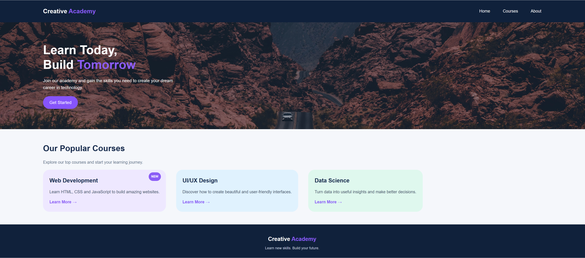

# 🎨 Creative Academy

A modern and responsive landing page for a creative learning academy.

## 🌐 Project Repository

[View Repository on GitHub](https://shahdessam2004.github.io/GNI-task2-CSS/)

## 📸 Website Preview



## ✨ Features

- Responsive and clean website layout
- Navigation bar with Home, Courses, and About
- Hero section with a call-to-action button
- Popular courses section
- Web Development course card
- UI/UX Design course card
- Data Science course card
- Modern colors and rounded cards
- Background image in the hero section

## 🛠️ Technologies Used

- HTML5
- CSS3
- Git and GitHub

## 📂 Project Files

- `index.html` — Website structure
- `style.css` — Website styling
- `photo-1500530855697-b586d89ba3ee.jpg` — Hero background image
- `repo.png` — Website screenshot

## 🚀 Run Locally

1. Clone the repository:

   ```bash
   git clone https://github.com/ShahdEssam2004/GNI-task2-CSS.git
   ```

2. Open the project folder.
3. Open `index.html` in your browser.

## 👩‍💻 Author

**Shahd Essam**

[GitHub Profile](https://github.com/ShahdEssam2004)

---

⭐ If you like this project, feel free to star the repository.

